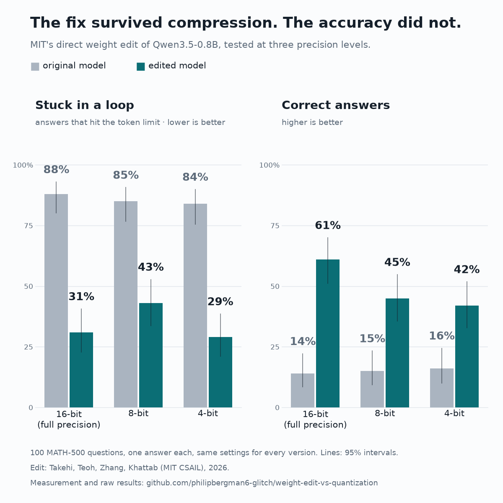

# Does a direct weight edit survive quantization?

**Status: run complete (2026-11-14). The reduction in looping survives 8-bit and 4-bit; accuracy drops. Two checks were added after the run (post-hoc): what rounding does to the edit ([`results/edit-rounding.md`](results/edit-rounding.md)) and the base model with thinking off at each precision level ([`results/controls.md`](results/controls.md)). See [`RESULT.md`](RESULT.md). Demo: `src/demo.sh`. README last checked 2026-11-22.**

Chart drawn by `src/chart.py` from `results/flags/`.

Interactive explainer: [`docs/`](docs/) (to be published with GitHub Pages; data built by `src/site_data.py`). Post video: [`media/post-video.mp4`](media/post-video.mp4), rendered by `media/render-video.mjs`.

## Credit first

The idea and the edit tested here are not mine.

- **Original work:** Takehi, Teoh, Zhang, Khattab (MIT CSAIL), "Sparks of Weight-Space Programming", blog post, 2 Nov 2026. https://rikiyat.github.io/blog/weight-space-programming/
- **Edited model:** `RikiyaT/Qwen3.5-0.8B-weight-space-programming` (Apache 2.0), base `Qwen/Qwen3.5-0.8B`.
- **Related work by another group:** Hu et al. (Shanghai AI Laboratory), "Exploring Weight-Space Programming", arXiv 2611.09382, 6 Nov 2026. It reruns the method and makes different edits; it does not test the edit used here and has no quantization experiments.

What they showed: a large model (GPT-6 Astra) read the weights of a small model and edited 131,072 of them (0.016%; both are their figures) so it repeats itself far less. Measured here, 130,188 of those weights actually differ from the base model; the other 884 round to the same bfloat16 value (`results/diff.md`). No training. On MATH-500, answers that ran into the token limit fell from 93.0% to 33.1%, and accuracy went from 7.9% to 48.1%.

## The question this repo asks

A model that runs on private or small hardware is usually quantized: every weight is stored with fewer bits, which adds small rounding errors. The edit touches very few weights, but changes them strongly (`results/diff.md`). **Does the fix still work at 8-bit and 4-bit?**

My contribution is the measurement, not the edit.

## Why the answer is not obvious

- Small weight changes can be rounded away. Zhang et al., "Catastrophic Failure of LLM Unlearning via Quantization" (ICLR 2025, arXiv 2410.16454): averaged over unlearning methods with utility constraints, models kept 21% of the "forgotten" knowledge at full precision and 83% after 4-bit quantization. The same paper reports that 8-bit models behave like full-precision ones.
- This edit is a different kind of change: a rank-one change to two tensors (in each, one direction holds 99.999% of the change), and large where it lands (62% to 85% of the touched columns' size, `results/diff.md`). The authors say Astra "subtracted that direction from 64 output columns in each". It does not simply erase the direction: the touched columns get larger, not smaller (combined norm 2.058 to 2.505 in layer 15, 2.247 to 2.521 in layer 19, `results/diff.md`). Refusal-direction removal (Arditi et al. 2024, arXiv 2406.11717) is also a single-direction weight change, and the authors compare the edit to it; that method erases the direction instead, and that paper does not test quantization.
- A direction can survive while the behaviour does not. Kadadekar (arXiv 2606.10154): in quantized models the refusal direction stayed almost unchanged (cosine above 0.97) while refusal fell by 12 to 68 points. That is about built-in refusal, not a weight edit.

## What others already did (so nothing here is over-claimed)

Re-checked against primary sources on 2026-11-22; quotes and links are in [`research/prior-work-and-mit-procedure.md`](research/prior-work-and-mit-procedure.md) (12 Nov) and [`research/recursive-self-improvement-and-weight-editing.md`](research/recursive-self-improvement-and-weight-editing.md) (22 Nov). Third-party numbers below are read from their own pages, not re-run by me.

- Replicating and re-applying the edit: done many times, byte-for-byte.
- **4-bit, 500 questions (TurinTech, 4 Nov 2026):** the edited model at full precision vs their 4-bit file, 500 MATH-500 questions x 4 samples, same llama.cpp setup: 46.95% vs 45.20% accuracy, with 40.55% of answers reaching the token limit in both. Their 4-bit file is calibrated (tuned per tensor), and the base model was not run on MATH-500.
- **4-bit, 40 questions (qxlsz, MLX plain 4-bit):** 27.5% of answers hit the limit, so looping stayed reduced, but it solved 12 questions against 21 for the same model at 16-bit.
- **8-bit:** at least two independent llama.cpp replications ran on 8-bit files (NeoCortex reports the edit working there); I found none that compares 8-bit with full precision on the same setup.
- Other editor models have been used (including Claude models).
- Known criticisms, with numbers: the base model with "thinking" off scores 45.8% against 50.2% for the edited model with thinking on (JonathanColetti, 500 x 4; the thinking-off run used its own settings and an 8k token limit); with thinking off for both, up to 8,192 tokens, the base model scores 43.6% and the edited one 45.2% (hedwigai, 18 Nov); the same edit scored 55% or 25% on the same 40 questions depending on llama.cpp sampler settings (NeoCortex, on an 8-bit file); a plain steering vector along the same direction reaches 50.8% (nathanrs), which is why some call it ordinary steering.
- Sampler: one evaluator reports that with greedy decoding and no presence penalty the edit scores 5% with 95% of answers at the 32K limit, against 52% and 28% with the published sampler (Nondual-Observer, author of a competing edit, discussion #5 on the edited model's page; full MATH-500, temperature and penalty changed together). Not re-run here. Every row in this repo used the published sampler (presence penalty 1.5, `results/table.md` Settings), so "survives quantization" is measured under that sampler only.
- **The authors' reply (12 Nov, added to the blog post):** on thinking off, "Turning thinking off raises the base score, but it does not fix the weights." They also say the baselines "are not there to rank methods against each other on equal terms", and, comparing Astra with interpretability researchers: "we have no reason to believe it would beat every one of them at any particular skill."
- **Newer preprints (read at arXiv; not peer reviewed):**
  - Fischetti (arXiv 2611.21432): for another group's re-derivation of the edit (a rank-one edit at the same two layers, found by a linear program; not the released tensors), a sort over 8 neurons scores 67.0% against 67.4% on 1,000 problems; "on this model, the edit acts as a nearly constant bias along u".
  - Salloum and Ali (arXiv 2611.14210): a bit-level search with "zero LLM tokens" scores 54.6% on MATH-500 against 51.7% for the agent's edit, same protocol.
  - Kundu (arXiv 2611.20953): Claude Opus 5.5 as the editor raised MATH-500 from 6.7% to 58.1%, with a different fix: "every edit acted at the output".
  - Fan et al. (arXiv 2611.21885): a 27B model edits its own weights and scores 6.6 points higher on 490 held-out maths problems. From its own text: each session starts "from the base weights"; of eight sessions it "withdraws in five and submits in three"; the larger gain makes "fewer of its answers run out of tokens"; smaller models "make no edit or break themselves".

**Still open, and what this repo adds:** the base model and the edited model side by side at full precision, 8-bit and a stock (uncalibrated) 4-bit file, on a single setup with the same settings everywhere, so the reduction in looping is measured at each precision level. 100 questions at the authors' 32,768-token limit, with the setting-only baselines included (the optional extension to 200 was not run). Searched again on 2026-11-22 (the model page's discussions, Hugging Face, GitHub, arXiv): I found no published run of the base model at each precision, no 8-bit comparison and no stock 4-bit test above 40 questions.

## Plan

| # | Step | Output |
|---|---|---|
| 1 | Download base and edited model, record hashes | `models/`, `results/hashes.txt` |
| 2 | Sanity check: diff the weights, confirm where the edit is | `results/diff.md` |
| 3 | Write the prediction and pass bars **before any test run** | `PREDICTION.md`, committed |
| 4 | Build 8-bit and 4-bit versions of both models | six model versions |
| 5 | Baselines on the unedited model: thinking off; repetition penalty | rows in the table |
| 6 | Run the same questions on every version, offline, identical settings | `results/table.md` |
| 7 | One-page write-up: table, prediction vs outcome, limits | `RESULT.md` |

Optional, only if time: sweep the edit strength; measure the edit size against the rounding step (done after the run: `results/edit-rounding.md`).

## Rules for this repo

- Prediction is committed before the first test run. It is never edited afterwards.
- Same sampler settings for every version. Settings are written into the results file.
- Every number in the write-up traces to a file in `results/`.
- A failed or messy result is reported as it is.

## Demo

Wi-Fi off. One maths question to two models side by side: the base model loops, the edited one answers. Then the 4-bit edited version on the same question. Run `src/demo.sh base-BF16` and `src/demo.sh edited-BF16` in two terminals (same settings as the run).
